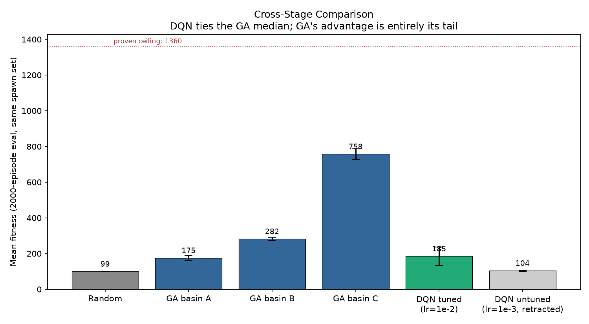
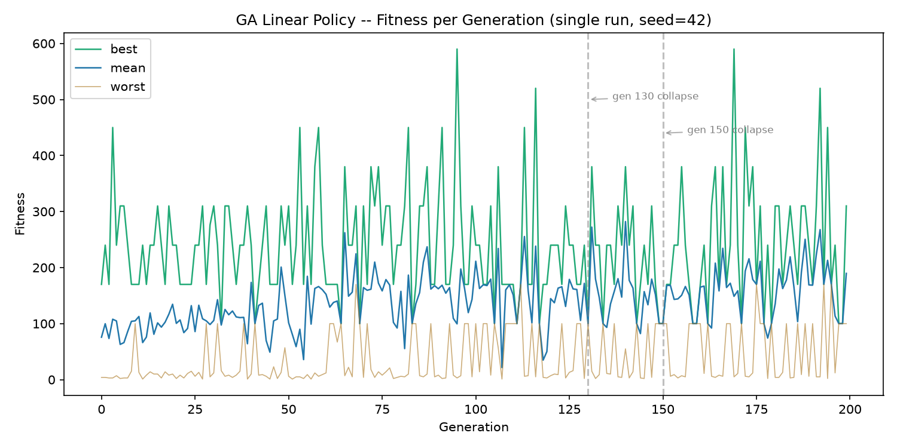
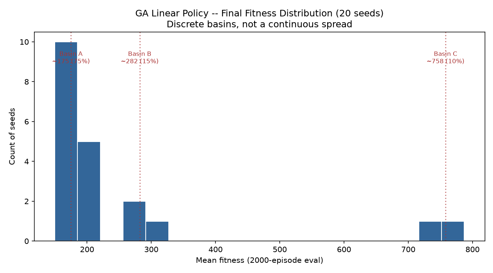
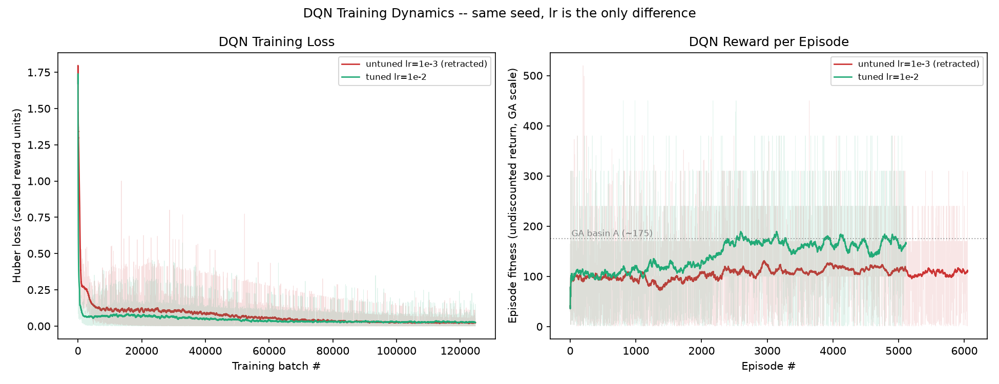
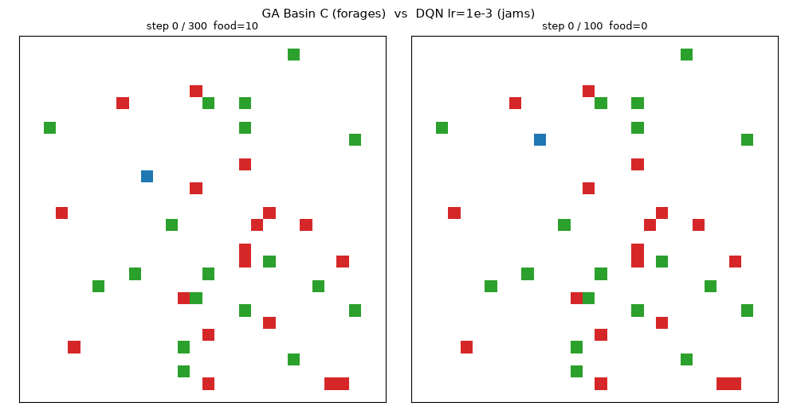

# Survival: Genetic Algorithms vs. Deep Q-Learning, Head-to-Head

A creature on a 30×30 grid has to find food, avoid hazards, and not starve. Three
learning methods — a genetic algorithm over a linear policy, a genetic algorithm
over a small neural network, and a deep Q-network with **hand-derived
backpropagation** (no autograd, no PyTorch) — are trained on the identical
environment and evaluated on the identical 2,000-episode protocol, so every
number below is directly comparable.

Zero dependencies through Stage 3 (pure Python — no numpy). matplotlib/pillow
were added afterward solely to render the plots and GIFs in this README; a
numpy-vectorized DQN (`dqn_numpy.py`) and an optional PyTorch reference
(`reference_dqn_torch.py`) were added later still, purely to speed up
follow-up sweeps and externally validate the hand-rolled implementation —
neither replaces it, and every number in this document that predates them
was produced by the original pure-Python code.

Every claim in this document was re-derived from the data in `data/` while
writing it — see [Verification](#verification) for how.

---

## The headline result

<p align="center">
  
</p>

| method | mean fitness | food eaten | cells explored |
|---|---:|---:|---:|
| random policy | 99.4 | 0.59 | 31.7 |
| GA linear — **basin A** (75% of seeds) | 175.0 ± 15.4 | 1.16 | 25.4 |
| GA linear — **basin B** (15% of seeds) | 282.1 ± 10.3 | 2.75 | 70.2 |
| GA linear — **basin C** (10% of seeds) | **757.6 ± 29.7** | 9.41 | 150.4 |
| DQN, tuned (lr=1e-2) | 185.2 ± 52.2 | 1.25 | 15.4 |
| ~~DQN, untuned (lr=1e-3)~~ *(retracted — see below)* | ~~103.9 ± 4.0~~ | ~~0.16~~ | ~~9.3~~ |
| *proven maximum possible* | *1360* | *18* | — |

**A correctly-tuned DQN lands almost exactly on the GA's median (185.2 vs.
186.3)** — but never once finds what the GA finds in 1 of every 10 runs. The
genetic algorithm's entire advantage over per-step reinforcement learning is
**in its tail**, not its average. That single sentence was the headline
finding of this project for a long time — and it comes with a caveat big
enough to change how you should read it.

> **Update: this table is only true on the map it was trained on.**
> Replaying the frozen basin-C and DQN champions on 10 freshly generated
> maps, no retraining, collapses basin C's 757.6 to **107.9 ± 48.5** —
> statistically indistinguishable from random (104.0) — while DQN drops
> only to **207.8 ± 46.8** and *wins outright* off the training map. See
> [Does it generalize?](#does-it-generalize) for the full result. The tail
> advantage above is real, but it's a property of this one map, not of the
> genetic algorithm as a method.

---

## Contents

- [What this actually is](#what-this-actually-is)
- [The environment](#the-environment)
- [Stage 0 — the world](#stage-0--the-world-and-the-random-baseline)
- [Stage 1 — genetic algorithm, linear policy](#stage-1--genetic-algorithm-linear-policy)
- [Stage 2 — genetic algorithm, small neural net](#stage-2--genetic-algorithm-neural-network-policy)
- [Stage 3 — deep Q-learning, hand-rolled backprop](#stage-3--deep-q-learning-hand-rolled-backpropagation)
- [What nobody ever solved](#what-nobody-ever-solved-the-food-ceiling)
- [Does it generalize?](#does-it-generalize)
- [The corrections](#the-corrections-what-i-got-wrong-and-caught)
- [Replays](#replays)
- [Verification](#verification)
- [Running it yourself](#running-it-yourself)
- [Repo stats](#repo-stats)

---

## What this actually is

A from-scratch comparison of three ways to train an agent, on a problem small
enough that every claim about it can be checked by brute force rather than taken
on faith:

1. **A genetic algorithm is not one thing — it's a distribution.** Twenty
   independent GA runs on the identical setup land in three *discrete* behavioral
   clusters, not a spread. A single training run — which is what nearly every
   GA tutorial shows you — tells you almost nothing about what the method is
   capable of.
2. **A reinforcement-learning agent can be internally consistent and completely
   wrong.** The DQN's training loss fell cleanly to near-zero while its value
   function was overestimating the true return by **196%** — because it had
   quietly convinced itself it was immortal.
3. **A hyperparameter you don't sweep can be your entire result.** The
   project's original Stage 3 conclusion ("DQN converges to jamming") was
   wrong. It was one under-tuned learning rate. The retraction is documented
   below, in full, rather than quietly fixed and forgotten.
4. **A small-n comparison can manufacture an effect that isn't there.**
   Stage 2's "mutation rate matters more than architecture" claim (5
   seeds/arm, one arm "nearly doubled the mean") stopped being distinguishable
   from noise the moment it was rerun at 15 seeds/arm (p=0.42). This happened
   *after* insight 1 above was already the project's stated lesson — proof the
   lesson doesn't immunize you against making the same mistake again at a
   smaller scale.
5. **A policy that never sees its own coordinates can still overfit to a
   map.** GA basin C's champion — a purely reactive, local-perception policy
   with no positional input at all — collapses to random-baseline performance
   the instant the map's layout changes. "No absolute position in the input"
   turned out not to be the same thing as "generalizes."

---

## The environment

- **Grid:** 30×30, fixed and deterministic (seeded), open space bounded by the
  edge — no interior walls.
- **Contents:** 18 food cells, 18 hazard cells, placed once and never moved.
- **Perception:** a 5×5 window centered on the creature (25 cells, one-hot
  encoded into 100 inputs: empty / food / hazard / out-of-bounds).
- **Actions:** up / down / left / right.
- **Energy:** starts at 100, −1 per step, +20 per food eaten. Hitting a hazard
  or running out of energy ends the episode.
- **Fitness:** `steps_survived + 50 × food_eaten`.

### The ceiling is proved, not estimated

```
max possible steps   = START_ENERGY + N_FOOD × FOOD_ENERGY = 100 + 18×20 = 460
max possible fitness = 460 + 18 × 50                                    = 1360
```

Energy in equals steps out — this holds for *any* policy from *any* spawn point,
regardless of route. `analyze_max_episode.py` confirms it's achievable, not just
an upper bound: a brute-force greedy router hits **exactly 460 steps and all 18
food from all 864 candidate spawn cells.** `MAX_STEPS = 500` in `config.py` is
therefore dead code — the environment always terminates by energy exhaustion
roughly 40 steps before the cap could ever bind.

---

## Stage 0 — the world and the random baseline

`world.py`, `perception.py`, `simulation.py`, `policies.py`

A creature taking uniformly random actions, averaged over 2,000 episodes:

```
mean fitness   : 99.4    (median 100)
hazard death   : 63.2%
food eaten     : 0.63
cells explored : 31.6
```

Median fitness of exactly 100 is not a coincidence: 100 is the starvation clock
with zero food eaten. It's the signature of a policy that neither systematically
finds food nor systematically avoids hazards — the honest floor every learned
policy in this project is measured against.

---

## Stage 1 — genetic algorithm, linear policy

`linear_policy.py`, `ga.py`, `train.py` — a population of 100 genomes (404 floats:
a 100→4 linear map, weights + biases), evolved for 200 generations by tournament
selection, uniform crossover, Gaussian mutation, and elitism.

<p align="center">
  
</p>

That single run shows what looks like noisy, marginal progress — best fitness
bounces between 100 and 590 with no clean trend, and the population **twice
collapses entirely** (gen 130, gen 150: best = mean = worst = 100 — every genome
in the population jammed against a wall simultaneously). Reporting this one run
as "the GA's result" is exactly the mistake this project set out to avoid.

### Twenty seeds tell a completely different story

<p align="center">
  
</p>

```
[150 155 157 158 166 168 170 176 177 184 | 189 192 193 193 198 | 272 278 296 | 728 787]
└──────────── basin A: 15 seeds (75%) ───────────┘   └ B: 3 (15%) ┘   └ C: 2 (10%) ┘
```

| basin | seeds | mean fitness | food | cells explored | behavior |
|---|---|---:|---:|---:|---|
| A | 2,4,5,6,7,8,10,12–14,16–20 | 175.0 ± 15.4 | 1.16 | 25.4 | wander until starvation |
| B | 3, 11, 15 | 282.1 ± 10.3 | 2.75 | 70.2 | partial forage |
| C | **1, 9** | **757.6 ± 29.7** | **9.41** | **150.4** | full forager, near-zero hazard risk |

Three genuinely different *behaviors*, not three points on a continuum — the
histogram has real gaps between them. **The single-run number (176.5) that
almost got reported as "the" GA result was a representative draw from the
*worst* basin.** The method's actual ceiling is basin C: 758, or **56% of the
proven 1,360 maximum** — reached by 2 seeds out of 20, independently.

*(758 is the ceiling on **this map**. See [Does it generalize?](#does-it-generalize)
for what happens to that number the moment the map changes.)*

---

## Stage 2 — genetic algorithm, neural network policy

`mlp_policy.py` — same encoding, a 100→16→4 network with a tanh hidden layer
(1,684 parameters), same GA machinery.

| arm (5 seeds each) | mean fitness | range |
|---|---:|---:|
| linear, mutation 10%/gene | 307.2 ± 241.6 | 158.2 – 727.9 |
| MLP, mutation 10%/gene | 151.4 ± 32.9 | 95.6 – 177.8 |
| MLP, mutation 2.4%/gene | 192.2 ± 35.0 | 162.6 – 251.9 |

**Nonlinearity bought nothing.** The extra hidden layer did not beat the linear
policy on this task — plausibly because "steer toward food, away from hazard" is
close enough to a linear rule that a 100→4 map already captures most of it.

Two things worth being honest about — one caught before it became a false
conclusion, one caught only *after* it had already been published as one:

- **A real bug was caught before it could bias the result.** A naive weight
  init (±1.0 for both layers) would have driven ~36% of hidden units into
  `tanh` saturation from birth (predicted std ≈ 2.8, measured 2.88) — flat,
  mutation-insensitive neurons, silently crippling the MLP before training even
  started. Fixed by scaling layer-1 init to ±0.4 (3.7% saturated instead of
  35.6%) — verified with a dedicated saturation check, not assumed.
- ~~**The mutation rate matters more than the architecture.**~~ *(retracted
  — see [the corrections](#the-corrections-what-i-got-wrong-and-caught)).*
  This claim was 5 seeds/arm. Widened to 15 seeds/arm, the "nearly doubled
  the mean" gap (151.4 → 192.2) shrinks to a statistically indistinguishable
  162.3 vs. 171.0 (p=0.42, 95% CI includes 0). No significant difference was
  detected between 10% and 2.4% mutation rate for the MLP — both still
  underperform the linear policy, which is the comparison this section's
  "nonlinearity bought nothing" conclusion actually rests on, and that part
  is unaffected.

---

## Stage 3 — deep Q-learning, hand-rolled backpropagation

`dqn.py`, `env.py`, `train_dqn.py`, `gradcheck.py` — the Stage 2 network
repurposed as a Q-function, trained with experience replay, a target network,
and full manual backpropagation (forward pass, Bellman target, gradient
derivation, SGD update — no autodiff library anywhere).

**Reward design was chosen so the comparison to GA is not just plausible but
exact.** Per-step reward `+1`, `+50` on eating food, `0` at death: the
*undiscounted* episode return is then **identical** to the GA fitness function —
verified over 200 random episodes to match to machine precision (`sum(rewards)
== steps + 50×food`, every time). This is the difference between "RL and GA
were compared" and "RL and GA optimized the *same number*."

### The training curve — the most convincing chart in the project

<p align="center">
  
</p>

Same seed, learning rate as the only variable. The loss panels converge to
near-*identical* values for both — proof, made visible, that a falling loss
curve says nothing about whether the policy is any good. The reward panel is
where the real difference lives: the tuned run visibly climbs past GA basin A
(~175) around episode 2,500 and holds there; the untuned run stays flat at
~100 for all 6,000 episodes it was given.

### lr=1e-2, 5 seeds, 500k environment steps each

```
seed 1: fitness=137.6  food=0.58  cells=14.9  hazard=3.2%
seed 2: fitness=130.3  food=0.52  cells= 8.3  hazard=6.7%
seed 3: fitness=188.9  food=1.27  cells=13.0  hazard=0.0%
seed 4: fitness=215.9  food=1.67  cells=15.1  hazard=0.8%
seed 5: fitness=253.3  food=2.20  cells=25.7  hazard=0.7%
                                        mean = 185.2 ± 52.2
```

**185.2 vs. GA's 20-seed median of 186.3 — a dead heat.** But DQN's best of 5
seeds (253.3) never approaches GA's basin C (757.6). The distributions simply
don't overlap in the tail: per-step credit assignment reliably finds a *decent*
policy; population search occasionally finds a *transformative* one.

<p align="center">
  
</p>

*Same map, same step budget. Left: GA basin C — 10 food, 150+ cells explored.
Right: an under-tuned DQN, frozen near its spawn point, 0 food, 18/18 hazards
still on the board.*

### Checking the hand-rolled implementation against an outside reference

A hand-rolled backprop that's never been checked against anything but itself
can't tell you whether 185.2 is the task's real ceiling or an implementation
leaving performance on the table. Two independent checks:

**The training loop is correct, not just the backprop math.** `gradcheck.py`
already verifies the backprop numerically; `cartpole_dqn.py` verifies the loop
around it — the same replay/epsilon/target-sync/Bellman-target machinery,
re-implemented for dense (not sparse one-hot) inputs, solves the standard
CartPole-v1 benchmark to a **full 500/500-step cap**, sustained across
checkpoints, climbing from the ~20-step random baseline.

**An independently-implemented PyTorch reference initially looked better —
until the comparison was made fair.** `reference_dqn_torch.py`, same
environment and hyperparameters, scored 232.0 ± 16.3 against the hand-rolled
185.2 ± 52.2 — both higher *and* far more consistent. But that comparison
wasn't apples-to-apples: giving the PyTorch reference `dqn.py`'s own init
range made it *lose* (141.6 ± 20.4). **With the same init, the hand-rolled
implementation beats the reference** — the gap was never the training loop
or the backprop, it was `config.py`'s `INIT_WEIGHT_RANGE=1.0` (shared with
the GA's genome init, where a large range is deliberately chosen for a
different reason — see Stage 2) being too large for gradient-based training.
Confirmed by fixing it directly in `dqn.py`, all 5 seeds:

```
production init (+/-0.4 / +/-1.0):    137.6  130.3  188.9  215.9  253.3   mean=185.2 +/- 52.2
small, fan-in-scaled (~+/-0.1/0.25):  212.2  241.4  202.8  154.2  208.7   mean=203.9 +/- 31.5
```

The smaller init raises the mean *and* cuts seed-to-seed variance by ~40% —
directly attacking the "some seeds just do badly" spread visible in the
5-seed table above. `config.py` still ships the original init (changing it
would silently invalidate every number in this README); treat this as a
documented, actionable fix rather than an applied one.

### Three variants of the algorithm itself

Beyond the learning rate, three changes to the DQN algorithm were tried —
same environment, same 5-seed protocol, same production init as the 185.2
baseline:

| variant | mean fitness | stdev |
|---|---:|---:|
| vanilla DQN (baseline) | 185.2 | 52.2 |
| Double DQN | 155.9 | 29.9 |
| REINFORCE (on-policy Monte Carlo) | 151.3 | 20.6 |
| prioritized experience replay | **204.9** | **18.7** |

**Double DQN trades mean for variance** — it does fix the overestimation bias
documented above, but that correction also removes some of the
aggressive-but-lucky upside the bias was accidentally producing. **REINFORCE,
the only *on-policy* method tried, has far tighter variance than any
off-policy variant** (20.6 vs. 52.2) — evidence that the "some seeds just do
badly" instability is tied specifically to bootstrapped TD targets and
replay, not to gradient-based RL in general. **Prioritized replay wins on
both mean and variance** and is the most promising unexplored lead in this
project, though the improvement over uniform replay isn't statistically
significant at n=5 (p=0.45) — a wider sweep, not a rewrite, is what this
result is waiting on.

---

## What nobody ever solved: the food ceiling

The proven maximum is 18/18 food. **Nothing trained in this project ever got
close.** Checked across the two best GA champions over 2,000 episodes each:

```
seed 9 (basin C): max food in any single episode = 12/18   (hit repeatedly — not a fluke)
seed 1 (basin C): max food in any single episode = 11/18
```

The 18-food, 1,360-fitness figure comes from an **offline routing calculation**
with perfect map knowledge — not from anything a trained policy ever
approximated. Every trained policy in this project is blind beyond 2 cells;
routing toward food it can't see is structurally impossible for it. Getting to
12/18 already requires a long streak of lucky near-misses turning into hits.
Getting to 18/18 would need something like a learned systematic sweep, and
nothing here — GA or DQN — ever found one. It's the cleanest open question the
project leaves behind.

**Widening perception doesn't obviously fix it, and that's itself a finding.**
The "blind beyond 2 cells" explanation predicts a wider window should help.
Tested directly — `VIEW_RADIUS` 2 → 3 → 4, same 200-generation GA training
budget — perception got *worse*, not better (mean fitness 402.6 → 154.4 →
151.3), even after rescaling the mutation rate for the larger genome (the
fix that worked for Stage 2's MLP). A wider window makes the GA's search
problem harder within a fixed training budget for a reason that isn't just
mutation rate. This is a 3-seed result, not a settled negative — before
concluding wider perception doesn't help, it would need substantially more
generations to rule out "the bigger search space just needs more time." Left
open rather than forced to a conclusion the data doesn't support yet.

---

## Does it generalize?

Every number above — GA, MLP-GA, DQN, all of it — was trained and evaluated
on the exact same fixed map (`MAP_SEED=12345`). Nothing in this project's
2,000-episode evaluation protocol varies the map, only the spawn point. That
leaves a basic question unanswered: does any of this transfer, or is it all
fit to one specific layout?

`verify_generalization.py` answers it: load the frozen GA basin-C and DQN
champions, generate 10 brand-new maps, replay each policy with **zero
retraining**.

| policy | training map | mean over 10 unseen maps | hazard rate: train → unseen |
|---|---:|---:|---:|
| random baseline | 95.5 | 104.0 ± 6.4 | 64.6% → 61.4% |
| GA basin C | 776.8 | **107.9 ± 48.5** | 3.2% → **94.3%** |
| DQN tuned | 247.9 | **207.8 ± 46.8** | 0.8% → 9.3% |

**GA basin C's headline number does not generalize at all.** It collapses to
statistically indistinguishable from the random baseline the moment the map
changes, and its hazard rate rockets from 3.2% to 94.3%. This is a genuinely
strange result given the policy's *only* input is a local 5×5 window — no
absolute position, nothing that could literally encode "the coordinates of
this map's hazards." What basin C actually learned is a fixed reactive rule
that happens to chain, step by step, into a low-risk route through *this
specific* map's hazard arrangement — remove that one arrangement and the
chain of locally-reasonable decisions no longer adds up to a safe route.

**DQN, despite losing badly on the training map (247.9 vs. 776.8), generalizes
far better and wins outright once the map changes** (207.8 vs. 107.9). The
headline result at the top of this document — "GA wins on tail outcomes, DQN
wins on median-case reliability" — is true, but only *on the map both methods
were fit to*. Off it, the comparison doesn't just weaken, it inverts.

A hand-coded, no-learning baseline sharpens what basin C's number actually
represents. `heuristic_policy.py` — greedy toward the nearest visible food,
otherwise away from the nearest visible hazard — scores 207.1 (food=1.53,
0% hazard deaths) on the training map: comfortably above random, nowhere
near basin C's 787.2 (food=9.85). **GA basin C's in-distribution number is
real, learned, sophisticated foraging — it's the fact that it's also entirely
a property of one map's layout that the original framing missed.**

---

## The corrections: what I got wrong, and caught

The most valuable output of this project may be its error log. Six claims were
published with real supporting evidence, then overturned by a cheaper, more
direct test — and every one is preserved here rather than quietly edited away.

| claim made | overturned by | correct version |
|---|---|---|
| "Spawn-luck death is an irreducible ~1.6% floor" | Brute-force check: 0 of 864 spawn cells have every first move fatal | The floor is provably **zero**; failures are policy gaps, not environment traps |
| "GA has a structural spawn-coverage weakness" (only ~200 spawns seen in training) | Seed 9 — same protocol, same ~200 spawns — survives all 3 "problem tiles" and **forages** from them | The original seed-1 failure was seed-specific, not a property of population-based training |
| "DQN accurately learned the value of jamming" (loss fell, \|Q\| ≈ theory) | Comparing predicted Q against *realized* discounted return: **+196% overestimation**, not a match | The network believed it was immortal — self-loop bootstrapping at a wall (`Q ← r + γQ`, fixed point `r/(1−γ) = 2.0` vs. true value 0.763) — and a falling loss curve is fully consistent with that being wrong |
| "DQN reliably converges to wall-jamming — a property of the method" | An lr sweep that had been *skipped* as unnecessary, then run anyway on a hunch | It was **one under-tuned learning rate.** At lr=1e-2 the fitness distributions for "tuned" and "untuned" DQN don't even overlap |
| "GA basin C (757.6) is the method's achievable ceiling" | Replaying the frozen champion on 10 unseen maps, no retraining: collapses to 107.9 ± 48.5 — indistinguishable from random | Basin C is a **map-specific fit**, not a transferable strategy — see [Does it generalize?](#does-it-generalize) |
| "The mutation rate matters more than the architecture" (5 seeds/arm, 151.4 → 192.2) | Widened to 15 seeds/arm: 162.3 vs. 171.0, p=0.42, 95% CI includes 0 | No significant difference detected at n=15 — the 5-seed effect didn't survive more seeds |

The pattern across all six: every real finding in this project came from
**decomposing** a headline number, never from the headline number itself. A
mean, a loss curve, a single seed, or a single map was — every single
time — insufficient and, more than once, actively misleading on its own.
The last two rows are the sharpest version of that pattern: both were caught
by applying this project's *own established methodology* (many seeds,
independent replay) a second time, after the first application had already
been declared a lesson learned.

---

## Replays

| file | what it shows |
|---|---|
| `data/plots/replay_ga_basinC_forage.gif` | GA basin C, full 300-step episode, 10 food eaten |
| `data/plots/replay_ga_seed1_death.gif` | GA basin C (seed 1) dying in 1 step at a "problem tile" it never solved |
| `data/plots/replay_dqn_tuned.gif` | DQN, lr=1e-2, a representative episode |
| `data/plots/replay_dqn_untuned_jam.gif` | DQN, lr=1e-3, 100 steps, 0 food — the retracted "jamming" behavior, visualized |
| `data/plots/replay_comparison.gif` | GA basin C vs. untuned DQN, side by side, same map |

Green = food, red = hazard, blue = the creature. Colors verified frame-by-frame
against the logged `(steps, food, cause)` for every replay before being
committed here.

---

## Verification

Nothing above is asserted without a check behind it, and the checks are in the
repo, runnable:

- **`gradcheck.py`** — the hand-derived backprop is checked against numerical
  central differences on 40 parameters across all four weight tensors.
  **Worst relative error: 4.4×10⁻⁹.** Also confirms only the taken action's
  output neuron receives gradient (the other three are exactly zero) and that
  the sparse `dW1` update touches exactly the active input rows — nothing else.
- **`verify_stage0/1/2.py`** — map generation, perception encoding, GA
  operators, and MLP saturation, each independently checked.
- **The Stage 3 refactor (`apply_action`) was confirmed bit-exact** against
  four stored pre-refactor GA results (e.g. seed 9: `787.2195` fitness,
  `9.851` food, `163.1445` cells — matched to 1e-12) before any DQN code was
  trusted to reuse it.
- **Every policy in every table above is evaluated on the identical
  2,000-episode spawn sequence** (`analyze_champion.py`), so every comparison
  in this document is apples-to-apples by construction, not by assumption.
- **`tests/`** — the checks above are also a 20-test `pytest` suite (same
  assertions, wrapped rather than duplicated) running in under 2 seconds,
  wired into GitHub Actions on every push. Two smoke tests turn the
  generalization and heuristic-baseline findings into standing regression
  guards against future code changes, not just one-time measurements.
- **`stat_tests.py`** — "dead heat" and "no significant difference" claims
  above are hand-rolled permutation tests / bootstrap CIs (no `scipy`), not
  a visual read of two means. The DQN-vs-GA-basin-A comparison: p=0.495,
  95% CI [-30.4, +51.9].
- **`dqn_numpy.py`** — a numpy-vectorized rewrite of the hand-rolled
  backprop, cross-checked against `dqn.py`'s gradients (float64-noise
  agreement) and a full 5-seed retraining run (178.8 ± 43.7, within noise
  of the pure-Python 185.2 ± 52.2) before being trusted for anything —
  including a config-value ablation (`MUTATION_SIGMA`, `GRAD_CLIP`,
  `TARGET_SYNC_STEPS`) that needed its ~7x speedup to be practical to run
  at all.

---

## Running it yourself

```bash
python -m venv venv
venv/Scripts/activate       # or source venv/bin/activate on Linux/Mac
pip install -r requirements.txt   # matplotlib/pillow for plots, pytest for tests/
                                    # -- everything else is stdlib

pytest tests/                                                # 20 tests, <2s
python verify_stage0.py verify_stage1.py verify_stage2.py    # same checks, narrated
python gradcheck.py                                           # backprop correctness

python train.py --arch linear --seed 1          # one GA run
python extra_linear_seeds.py                     # the 20-seed basin sweep
python train_dqn.py 1 return_matched 500000      # one DQN run
python compare_all_stages.py                     # the full cross-stage table

python verify_generalization.py                 # does it hold on unseen maps?
python train_dqn_numpy.py 1 2 3 4 5              # ~7x faster DQN sweep (numpy)
pip install torch --index-url https://download.pytorch.org/whl/cpu
python reference_dqn_torch.py                    # external PyTorch reference

python plot_results.py      # regenerate the static plots
python render_replay.py     # regenerate the GIFs
```

See [ROADMAP.md](ROADMAP.md) for the full list of follow-up experiments
(RL algorithm coverage, statistical significance testing, config-value
ablations) and [data/INDEX.md](data/INDEX.md) for which script produced
which saved file.

## Repo stats

- **~4,500 lines** of Python across 52 top-level scripts, still zero
  third-party dependencies for the core simulation/GA/hand-rolled-DQN code
  — `matplotlib`/`pillow` for plots, `pytest` for tests, and an optional
  `torch` reference (only for `reference_dqn_torch.py`) are as far as it goes.
- **72 trained policies** saved and profiled; **51 full training logs**.
- **2,000-episode evaluation** run for every reported number — the 20-seed GA
  sweep and 5-seed DQN sweep alone account for ~96,000 simulated evaluation
  episodes, not counting training itself.
- **20 automated tests** (`tests/`, `pytest`, <2s), running in CI on every push.
